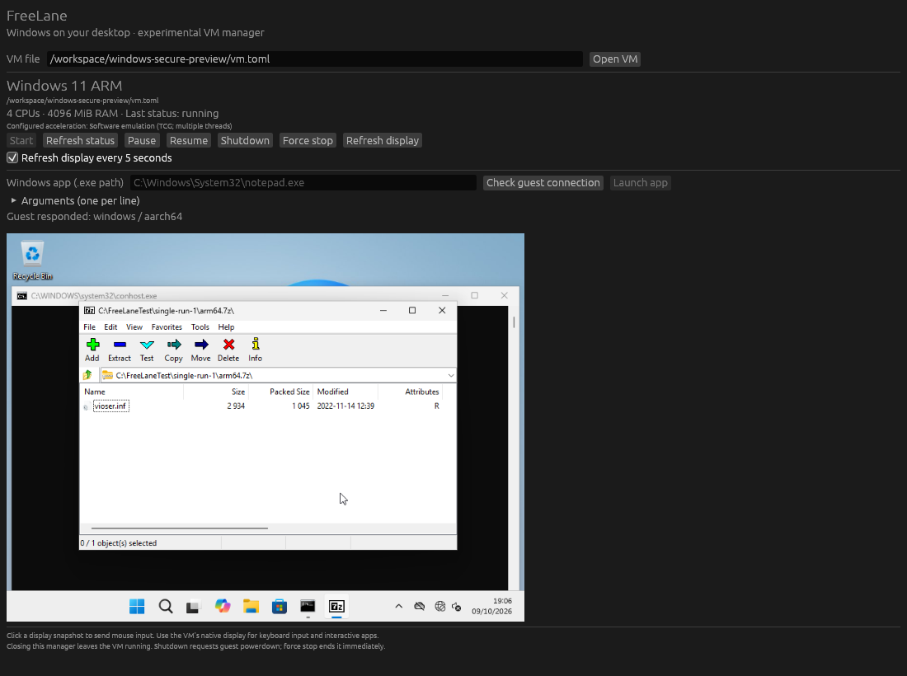

# FreeLane

### Windows on Mac. Free & Open Source.

**A Rust-based alternative to Parallels Desktop for Apple Silicon — built around an ambitious goal: broad Windows application support with less overhead.**

No subscription. Open code. Performance claims backed by measurements.

> **Project status: early development.** FreeLane is not ready for everyday Windows use yet. Windows 11 ARM has reached its installed desktop in Audit Mode under Linux software emulation. Verified 7-Zip x86, x64 and ARM64 created, tested and extracted archives with matching source bytes in an installed Audit trial; older extracted x86 data also matched after reboot. An earlier unexpected Windows kernel crash remains under investigation. Normal user setup, stable guest operation, native Mac runtime, accelerated graphics, game compatibility, and seamless app windows still require implementation or verification. No performance advantage over Parallels has been demonstrated.

## Why FreeLane?

Running Windows on a Mac should have a free, open-source option designed with Apple Silicon in mind. FreeLane aims to make that option practical: a small host application, a Rust virtualization core, and a clear path from a working Windows ARM guest to reliable everyday applications and, later, playable games.

The first target is **Apple M1**. Installing Windows and validating application compatibility come first. Accelerated graphics and gaming require a separate proven driver and rendering path.

## What we are building

| Goal | What success looks like |
| --- | --- |
| Windows on Apple Silicon | Install and boot a user-supplied Windows 11 ARM image |
| Smooth gaming | Stable frame pacing, useful 1% lows, and responsive input in tested games |
| Low overhead | Measure host and guest memory, idle CPU, swap, and energy use |
| Free, open-source host software | No FreeLane subscription; inspectable and buildable source |
| Native desktop experience | Eventually launch Windows apps from macOS and show individual app windows |
| Reproducible comparisons | Publish configurations, workloads, results, and known failures |

Being lighter and more compatible than Parallels is a **target**, not a present capability. Rust alone does not make a VM faster or reduce guest memory requirements.

## Architecture direction

The design is provisional. Feasibility experiments should decide the architecture before a large user interface is built.

- **Host:** macOS on Apple Silicon, starting with M1.
- **Core:** Rust VM lifecycle, configuration, memory ownership, and device boundaries.
- **CPU virtualization:** investigate Apple's Hypervisor.framework with a small native backend.
- **Guest:** Windows 11 ARM, with firmware and virtual devices selected after compatibility and license review.
- **Graphics:** an early research track for a Windows ARM virtual GPU driver and a macOS rendering backend; DirectX-to-Metal translation is a possibility to investigate.
- **Integration:** guest tools for application launch, clipboard, shared folders, and later individual-window presentation.

Windows support requires much more than starting a virtual CPU: firmware, interrupts, timers, storage, input, networking, and compatible guest drivers all need implementation or suitable existing components. The first experimental baseline uses a separately installed QEMU VMM, managed by Rust. This choice supplies a device model and HVF backend; it does not settle the Windows graphics architecture.

**Graphics is the highest-risk milestone.** Apple GPU passthrough is not assumed. A graphics prototype must demonstrate a viable driver and rendering path before gaming promises become product claims.

## Roadmap

| Milestone | Deliverable | Exit condition |
| --- | --- | --- |
| 0 — Foundation | Rust workspace, validated VM configuration, lifecycle boundaries, and host diagnostics | Portable tests pass; unsupported hosts fail clearly |
| 1 — CPU proof | Small Hypervisor.framework experiment on an Apple Silicon Mac | Guest code executes and exits correctly on real hardware |
| 2 — Graphics feasibility | Documented Windows ARM driver and rendering experiment | Demonstrate a supported graphics workload and record limitations |
| 3 — Windows boot | Firmware, disk, display, input, and networking | A reproducible Windows ARM install boots reliably |
| 4 — Gaming baseline | A small published game compatibility suite | Repeatable frametime and resource measurements on the same Mac |
| 5 — Efficiency | Tune measured bottlenecks; explore save and restore | Demonstrated improvements without compatibility regressions |
| 6 — Desktop integration | Guest tools and individual Windows app windows | Applications launch and interact reliably from macOS |

These are deliverables, not release-date promises. CPU and graphics experiments may proceed independently; a working GPU path is a gate for the gaming goal.

## Build and try

FreeLane now has a Rust CLI and an experimental QEMU-backed ARM VM runner: sparse disk creation, private firmware/NVRAM and TPM state, basic display/input, and VM controls. Linux integration tests execute ARM guest code and boot UEFI under software emulation. Installed Windows ARM Audit testing exercised three architectures of 7-Zip and a Notepad save/close/reopen workload. **Normal user setup, everyday stability, Mac HVF runtime, accelerated Windows graphics and performance advantages remain unverified.**

Install the pinned Rust 1.99.0 toolchain, then run from the repository root:

```sh
cargo build --locked --workspace
cargo test --locked --workspace
cargo run --locked -- doctor
```

Try the experimental desktop manager after building the workspace:

```sh
cargo run --locked -p freelane-desktop -- /absolute/path/to/vm.toml
```

It opens existing VM configurations, controls their lifecycle and displays snapshots, with optional refresh every five seconds and mouse clicks on the displayed snapshot. Start, pause, resume, and closing the manager while keeping the VM alive have been exercised on Linux. Display snapshots are still images; interactive guest input uses QEMU's native window. See [desktop instructions](docs/desktop.md).

Follow [build and VM instructions](docs/development.md) for QEMU/firmware prerequisites, VM creation, startup and real ARM/UEFI integration tests. `doctor` exits unsuccessfully on unsupported native hosts, including Linux. Linux remains useful for portable and TCG tests.

The separate native Hypervisor.framework diagnostic on macOS Apple Silicon creates and destroys an empty VM:

```sh
cargo build --locked --workspace
codesign --force --sign - --entitlements scripts/macos-hypervisor.entitlements.plist target/debug/freelane
./target/debug/freelane probe-hypervisor
```

This native probe still needs hardware validation and does not execute a guest. See [implementation status](docs/implementation.md) and [dependency decisions](docs/dependencies.md) for the current boundaries. An experimental [Windows guest agent](docs/guest-agent.md) has answered ping and launched actual Notepad/7-Zip windows through virtio serial in WinPE and the installed Audit desktop. The FreeLane GUI received the installed guest's ping and opened Notepad; editing used diagnostic keyboard controls, and saving/closing/reopening retained its text. Normal user integration remains unverified. No Windows installer or proprietary driver is bundled.

## Recorded desktop test

This is an actual Linux cloud capture of FreeLane controlling installed Windows ARM under TCG, with a guest ping response and a persisted 7-Zip archive open. It is a recorded correctness test, not a live preview or a native Mac performance result.



The same installed session saved and reopened a Notepad document. See [test evidence and known failures](docs/test-evidence.md) for the images, configurations and limits of these results.

## Vibe coding with VM tests

An experimental [stdio MCP server](docs/mcp.md) connects development tasks and registered VM controls to Codex, Cursor and Claude clients. It can run build/test jobs, report actual outcomes, start/control a VM, return real PNG screenshots and call the Windows agent. Python 3.11+ is required; the server uses only the standard library. A real Linux stdio/QEMU test passed. Client configuration and native Mac setup are documented separately; no client or remote Mac connection is automatically provisioned.

## How we will measure performance

Compare FreeLane and Parallels on the **same Mac, macOS, Windows build, vCPU count, guest RAM, game version, resolution, and graphics settings**. Record warm-up, workload duration, power conditions, and repeated runs.

Publish:

- Average FPS, 1% low FPS, frametime distribution, and stutter counts.
- Input latency and rendering or shader-related stalls where measurable.
- Host and guest memory, whole-system memory pressure, and swap.
- Idle CPU, boot and restore duration, and energy use where measurable.
- Crashes, visual defects, and per-game compatibility results.

Report failures alongside successes. No invented FPS numbers or projected memory savings.

## Compatibility boundaries

See the [application compatibility evidence](docs/compatibility.md) for passed experiments and pending runtime checks.

- Windows ARM's x86/x64 translation affects game compatibility and performance independently of the VM core.
- Kernel drivers and anti-cheat may prevent games from running. FreeLane will not promise universal game support or anti-cheat bypasses.
- Pausing a VM does not automatically return its allocated RAM. Releasing memory through save/restore requires explicit engine support and validation.
- Seamless app windows still depend on a running or restored Windows guest; they do not eliminate the guest operating system.

## Contributing

Early contributions are most useful when they reduce an unknown:

1. Small, reproducible Apple Silicon virtualization experiments.
2. Windows ARM firmware, device, or driver compatibility evidence.
3. Virtual GPU and rendering prototypes with explicit constraints.
4. Benchmark tooling and documented game failures.
5. Focused Rust changes with meaningful tests and clear error handling.

Before adding a dependency, record its license, maintenance status, supported platforms, and Windows guest limitations. Keep proposals small enough to review and reproduce.

## License and Windows

FreeLane's own Rust code and documentation are available under the [MIT license](LICENSE). Separately installed QEMU, firmware, TPM software and other dependencies retain their own licenses; see [dependency decisions](docs/dependencies.md).

FreeLane's intended free pricing applies to the host application. Users must obtain Windows and any games separately and comply with their licenses. Windows images, proprietary drivers, and game files will not be bundled without appropriate redistribution rights.

## Name and affiliation

FreeLane is an independent project. It is not affiliated with Apple, Microsoft, or Parallels. Product names belong to their respective owners. The working project name has not undergone trademark clearance.

---

**Build in the open. Measure on real hardware. Make Windows on Mac more accessible.**
