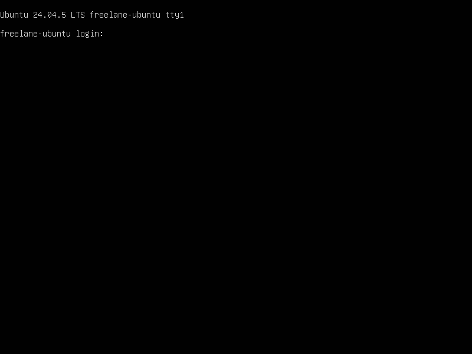

# FreeLane

An experimental, open-source VM manager for **Windows 11 ARM and Ubuntu ARM64**, targeting **macOS on Apple Silicon**.

FreeLane uses Rust to manage a separately installed QEMU backend. It provides a desktop manager, CLI and stdio MCP server for development and VM testing. The long-term goal is a free alternative to Parallels Desktop; everyday reliability, universal application support and a performance advantage have **not** been demonstrated.

## Current status

Runtime evidence below comes from **Linux cloud software emulation (TCG)**. macOS ARM64 compilation has been checked; running the desktop and guests with Mac hardware acceleration (HVF) still requires testing on a real Mac.

| Component | Implemented or observed | Remaining validation |
| --- | --- | --- |
| VM management | Windows/Ubuntu profiles, disk initialization, private firmware state, start/status/pause/resume/shutdown | Native Mac runtime and everyday reliability |
| Desktop manager | Blue-accented controls sidebar, editable VM settings, guest display snapshots, mouse clicks, optional five-second refresh, guest app requests | Native Mac GUI; continuous video and keyboard forwarding are not implemented |
| Windows 11 ARM | Installed Audit desktop; 7-Zip x86/x64/ARM64 archive checks; Notepad save/close/reopen | Normal user setup, stability and application coverage; an earlier kernel crash remains unresolved |
| Ubuntu ARM64 | Ubuntu Server 24.04.5 cloud image; unprivileged agent; file/copy/gzip/ZIP checks; exact data retained after reboot | Ubuntu Desktop, GUI apps, networking and native Mac execution |
| MCP | Real stdio/QEMU tests, development jobs, VM controls, PNG capture and guest ping/launch | Configuration in each editor; no remote Mac is automatically provisioned |
| Graphics and integration | Basic QEMU display, literal executable launch and opt-in read-only host folder as USB FAT media | Accelerated graphics, games, clipboard, two-way folder sync and seamless app windows |

Ubuntu Server was deployed from an official preinstalled cloud image with NoCloud provisioning, **not** installed through the graphical Ubuntu installer. A process-start response only confirms that the guest started a process; it does not prove that an application works.

See [test evidence](docs/test-evidence.md), [application compatibility](docs/compatibility.md) and [Ubuntu instructions](docs/ubuntu.md) for configurations, results and known limits.

## Build

Use the pinned **Rust 1.99.0** toolchain. VM execution also needs QEMU 10.0+, matching AArch64 EDK2 firmware, and swtpm for the Windows profile. Linux desktop builds need the platform development libraries described in [dependency documentation](docs/dependencies.md). Python 3.11+ is required only for MCP tooling.

```sh
cargo build --locked --workspace
cargo test --locked --workspace
cargo fmt --all --check
cargo clippy --locked --workspace --all-targets -- -D warnings
```

The ordinary test command skips six opt-in QEMU integration tests. [Development instructions](docs/development.md) explain their prerequisites and execution. `freelane doctor` intentionally rejects Linux as a native host; Linux remains usable for explicit TCG testing.

## Create and open a VM

Supply matching ARM64 firmware code and variable-template files. Windows needs Secure Boot capable firmware with Microsoft keys and a user-supplied Windows ARM installer. `init` creates a new directory with a sparse 64 GiB disk and refuses to overwrite an existing directory.

```sh
# Windows is the default profile.
./target/debug/freelane init /absolute/path/to/windows-vm /absolute/path/to/code.fd /absolute/path/to/vars.fd windows

# Ubuntu selects modern virtio storage and does not require a TPM.
./target/debug/freelane init /absolute/path/to/ubuntu-vm /absolute/path/to/code.fd /absolute/path/to/vars.fd ubuntu

./target/debug/freelane-desktop /absolute/path/to/ubuntu-vm/vm.toml
```

Before starting, configure the guest media in `vm.toml` using the [Windows setup guide](docs/development.md) or [Ubuntu setup guide](docs/ubuntu.md). Initialization alone does not install an operating system. Profiles default to HVF for Apple Silicon; Linux testing requires explicitly selecting `accelerator = "tcg"`. Networking defaults to off.

The desktop's **Open VM** loads the selected configuration. Editing the path does not change the active VM until it is opened. The controls sidebar shows resources, configured acceleration and the last observed status. The display area shows captured frames, rather than live video. Use QEMU's native window for keyboard input. Closing the manager leaves its VM running; prefer guest shutdown before force stop, which can lose unsaved data.

See [desktop instructions](docs/desktop.md) and [guest-agent setup](docs/guest-agent.md). The optional agent launches an absolute Windows `.exe` or Linux executable with literal arguments; it must be installed and running inside the guest.

Use **VM settings** to change CPU count, RAM, HVF/TCG, TCG threading, NAT/network adapter, native display, guest-agent channel, serial console and installer media. Settings are saved only while the VM is stopped, with a backup and conflict detection. The host folder option exposes a small folder as a **read-only USB FAT volume**; it is not two-way synchronization or physical-device passthrough. See [sharing limits and setup](docs/sharing.md).

The updated manager below has a disposable Ubuntu profile loaded while the guest is powered off; no guest frame is shown.


## Vibe coding and MCP

The [stdio MCP server](docs/mcp.md) exposes fixed development tasks and registered VM controls to compatible clients, including Codex, Cursor and Claude. It reports actual job outcomes, captures real PNG frames and supports both Windows and Ubuntu guest requests. It uses Python's standard library and does not expose an HTTP server or an arbitrary shell tool.

Follow the MCP guide to register VM paths and generate your client's configuration. Client settings and remote environments are not installed automatically.

## Recorded guest tests

These are genuine captures from Linux TCG testing, not native Mac performance results.

**Installed Windows ARM:** FreeLane received a guest ping and displayed 7-Zip with a persisted archive open. This image records the earlier manager layout.


**Ubuntu Server ARM64:** the console login screen from the installed cloud-image guest. This is a server console, not Ubuntu Desktop.



[Baseline and post-reboot reports](docs/evidence/ubuntu-after-reboot.json) record the Ubuntu storage checks. [Windows evidence](docs/test-evidence.md) includes the archive and saved Notepad tests, alongside failures and scope limits.

## Direction

Next priorities are native Apple Silicon validation, reliable guest setup and shutdown, wider application checks, and a proven accelerated graphics path. Performance work must use repeatable measurements on the same hardware and guest configuration. There are currently no verified FPS, memory-saving or Parallels comparison claims. See [implementation status](docs/implementation.md) and [benchmark instructions](docs/development.md).

## License

FreeLane source and documentation use the [MIT license](LICENSE). QEMU, firmware, TPM software and other dependencies retain their own licenses; see [dependency decisions](docs/dependencies.md). Users obtain Windows and proprietary applications separately under their respective licenses.

FreeLane is independent and is not affiliated with Apple, Microsoft, Canonical or Parallels.
