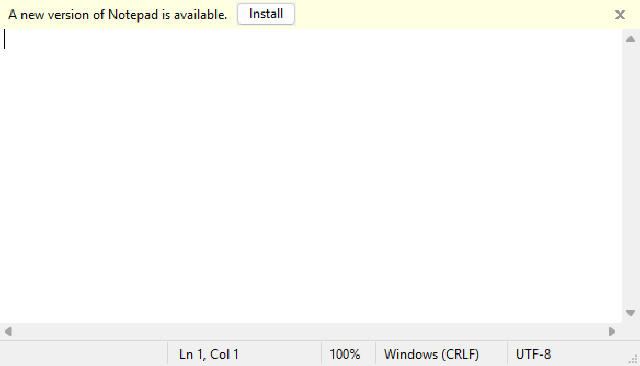
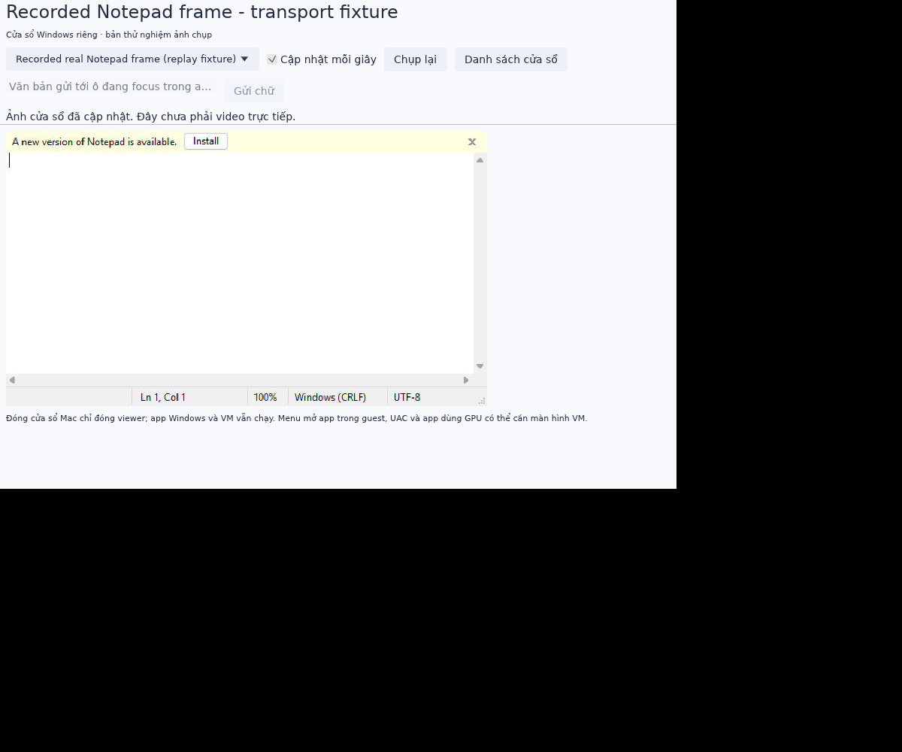

# Windows app windows and Dock launchers

FreeLane has an **experimental separate-window viewer** for ordinary Windows Win32 apps and can export a named macOS `.app` launcher per application. Drag that launcher to the Dock to open it later. It starts the configured VM if stopped, waits for the interactive Windows agent, requests one application launch, finds that process's visible windows and displays genuine client-area snapshots in a separate host window.

This is a first integration path, not Parallels Coherence parity. The viewer uses bounded JPEG snapshots, optionally refreshed one second **after the preceding operation finishes**. It is not continuous video or an accelerated remote graphics protocol. Native Mac/Dock behavior needs testing with a real installed Windows VM; Linux cloud tests exercise the guest transport and viewer separately.

## Download this revision

[Published prerelease with Mac and Windows agent ZIPs](https://github.com/puma2k/freelane/releases/tag/v0.1.0-preview.2). Earlier [Mac build](https://github.com/puma2k/freelane/actions/runs/38275323897#artifacts): `FreeLane-experimental-macos-arm64`. [Windows ARM64 agent](https://github.com/puma2k/freelane/actions/runs/38272833003#artifacts): `experimental-windows-arm64-agent`. Both packaging/upload jobs passed; sign in to GitHub to download. The broader second workflow has failed MCP steps, so its overall red status must not be described as a complete CI pass. [Build evidence](evidence/app-window-release-build.json) records these separately.

## Prepare Windows

Use the matching Windows ARM64 guest-agent build from this revision. Set `guest_agent=true` in the VM's `[runtime]` configuration and install the compatible signed ARM64 virtio-serial driver as described in [guest-agent setup](guest-agent.md). Run the agent in the signed-in user's interactive session. It must be available after login for Dock quick-open; the launcher does not log in or obtain credentials.

An optional per-user Startup shortcut installer is provided:

```powershell
powershell.exe -NoProfile -File .\install-windows-agent.ps1 -AgentPath 'C:\Downloads\freelane-guest-agent.exe'
```

It copies to the user's LocalAppData FreeLane directory and adds a minimized Startup shortcut. It does not create a service, elevate, disable UAC, install a driver or configure autologin. It refuses an existing installation; inspect and back up an old installation, stop its owned agent, then update explicitly. Sign in again to start it. An existing manual agent on the same serial port must be stopped first. This installer is separate from the driver installer and its production startup behavior has not been validated on a normal Windows user account.

Protocol v1 ping/launch remain compatible with the old agent. The viewer first probes the optional **v2 window extension** with a read-only ping; an old agent returns a version error and **no app launch is sent**. Install the updated agent before using app windows. Linux agents return `window_snapshots=false` and retain normal v1 operation.

## Save an application

In the manager's **Applications / Ứng dụng** tab for a Windows VM, enter the `.exe` and literal arguments, then fill in **App name** and a **new app profile path**. Choose **Save app profile** or **Save & open separate window**. Existing profile files are refused. On Mac, enter a new `.app` path and choose **Export Dock launcher** using the saved profile.

Alternatively copy [the Notepad example](../configs/app.notepad.example.toml):

```toml
name = "Windows Notepad"
vm = "/absolute/path/to/windows/vm.toml"
executable = 'C:\Windows\System32\notepad.exe'
arguments = []
boot_timeout_seconds = 600
```

Relative VM paths resolve against the profile. Arguments are literal strings, not shell text. Startup waits 10–900 seconds as configured (default 600); no launch is retried after an uncertain response. If readiness times out, the VM is left running for inspection. Paused/stopping VMs must be resumed explicitly. A VM startup lock avoids duplicate starts from simultaneous app viewers; ordinary QEMU locking remains active.

```sh
./target/debug/freelane-desktop --app /absolute/path/to/notepad.app.toml
# macOS only, creates and ad-hoc signs a new native launcher:
./target/debug/freelane app-export /absolute/path/to/notepad.app.toml '/Users/you/Applications/Windows Notepad.app'
```

The launcher contains copied CLI/desktop executables and a private saved profile with the canonical VM path. It has its own bundle identifier/name so it can be pinned independently in the Dock. Its icon is currently macOS's generic application icon; Windows icon extraction is pending. Moving the VM breaks that saved path; update/re-export explicitly. Exported launchers retain their copied binary version, so re-export to a new path after upgrading FreeLane. Use macOS14+; signing is ad-hoc, not Developer ID/notarization. The same [release security and backend prerequisites](release.md) apply.

When launching a stopped VM from Finder/Dock, the supervisor retains the inherited PATH and adds existing `/opt/homebrew/bin` and `/usr/local/bin` tool locations. Explicit backend paths in the VM config remain preferable. The launcher does not install QEMU, firmware, Windows, drivers or mobile SDKs.

## Interact with the viewer

- Select the desired visible window for the launched PID; refresh the list for dialogs in the same process.
- Click inside the captured image to send a mapped primary click and focus the host image.
- Type after focusing the image, or use **Gửi chữ** to send up to 1024 UTF-8 bytes to the guest window's focused control. Enter/Tab/navigation/Delete/Backspace/Escape are supported.
- Use **Chụp lại** or periodic refresh. Errors stop automatic refresh; inspect before sending another mutation.

Every guest window target includes HWND, PID and process creation time. The agent revalidates these before acting, so a recycled handle/PID is refused. Frames are bound to the selected identity, preventing late captures from a previously selected window from being displayed as another app. Input messages are delivered to that window/child control rather than injected globally. Delivery acceptance does not prove that an application used the input.

**Closing the Mac viewer leaves the Windows app and VM running.** Use the full VM display for unsupported menus/save/exit; unsaved-document dialogs remain the guest's responsibility. Reopening a closed viewer requests a new launch, which may create another app instance. Single-instance apps or launchers that delegate to another PID may not expose windows under the returned PID; inspect the VM rather than automatically launching again.

## Limits and validation

Capture uses Win32 `PrintWindow` in a bounded background worker, with at most one outstanding capture. A hung application may keep that worker pending; further captures fail until it completes. The agent still returns errors rather than leaving the serial request unbounded. Raw rasters are limited to 16 million pixels; JPEG previews adapt down from at most640×480 to fit 28 KiB, hex-encoded inside the existing64 KiB frame limit. Text can be less crisp than a live high-resolution stream.

Minimized windows must be restored inside Windows. UAC/secure desktops, protected video, GPU-heavy apps, games, cross-process windows and programs ignoring posted Win32 messages may fail or produce a blank frame. Dragging, scrolling, double-click, full keyboard modifiers/shortcuts, clipboard, audio, native app icons and seamless resize are not implemented. This mode does not create guest graphics acceleration or claim frame-rate performance.

Portable tests cover profile/bundle preservation, literal arguments, v1/v2 negotiation and wrong-window response rejection. Windows ARM64 builds/checks include the GDI/User32 branch. Native Mac release packaging additionally exports an offline Dock fixture, lints its plist and verifies its signature; it does **not** boot that fixture or claim Windows/Dock interaction. Recorded real guest tests are reported separately when available.

## Recorded Windows cloud observation

The updated ARM64 agent actually answered v1 ping and v2 window capabilities in the installed Windows Audit session through virtio serial. One Notepad launch returned PID6456; its visible window was identified by HWND131418 and process creation time. A separate640×366 JPEG of the real client area was returned (15,375 bytes). Targeted click/text requests were accepted, but the cloud session interrupted its processes before the after-input capture, so text rendering and the live host viewer were **not** validated in that session. This is not a normal-user, native Mac/Dock or stability result.



[Recorded partial acceptance](evidence/windows-app-window.json) preserves the successful capture and the interrupted input verification separately.

## Host viewer replay check

After the live guest session interrupted, the genuine captured Notepad JPEG was decoded and displayed by the host viewer over a read-only local RPC fixture. This verifies the host JPEG/render path and UI layout, not Windows input behavior or a live guest connection.



An explicit `freelane-desktop --app profile.toml --pid PID` can attach to the specified guest process without another launch; use a fresh verified PID, not a PID retained across reboot.
