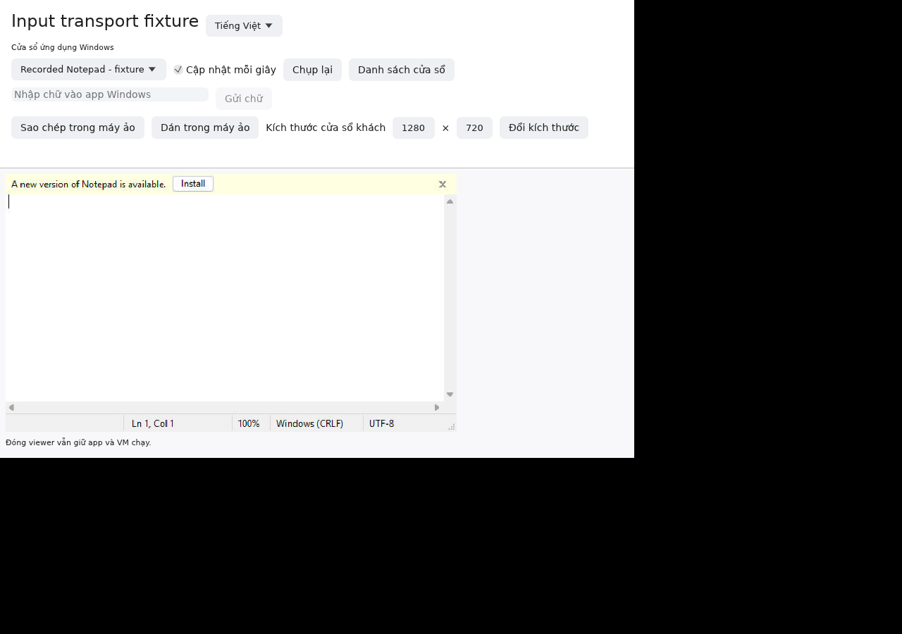

# Cửa sổ ứng dụng Windows

FreeLane mở app Windows bằng cửa sổ viewer riêng và có thể xuất launcher `.app` để ghim vào Dock. Viewer hiện dùng ảnh JPEG cập nhật định kỳ, chưa phải video Coherence. Xem [hướng dẫn cấu hình và giới hạn](app-windows.md).

Agent mới có giao thức v10 hỗ trợ chuột trái/phải, nhấp đúp, cuộn, kéo theo một thao tác khi thả chuột và yêu cầu đổi kích thước vùng nội dung. Chọn cửa sổ rồi nhấp vào ảnh để nhập chữ. Kéo dùng16 bước nội suy, không phải luồng chuột trực tiếp. Agent cũ vẫn dùng thao tác cơ bản; không âm thầm gửi thao tác mới xuống giao thức cũ.

Command trên Mac ánh xạ thành Ctrl trong Windows. Phím tắt chỉ được gửi nếu đúng cửa sổ khách đang ở phía trước và không có phím liên quan đang được giữ. Nếu bị từ chối, hãy kích hoạt cửa sổ trong Windows và kiểm tra trước khi thử lại. FreeLane không cưỡng ép focus hoặc tự phát lại thao tác chưa rõ kết quả.

**Sao chép trong máy ảo / Dán trong máy ảo** dùng clipboard của máy khách. Clipboard của Mac chỉ được chia sẻ qua các điều khiển bật riêng trong trình quản lý VM. **Kích thước cửa sổ khách** nhận chiều rộng/cao64–8192 pixel; app hoặc Windows có thể áp đặt giới hạn riêng. Đóng viewer vẫn giữ app và VM chạy.

Ảnh và thao tác UI này dùng màn hình Linux riêng cùng phản hồi RPC giả lập và ảnh Notepad đã ghi trước; không chứng minh thao tác trên Windows đang chạy hay Mac thật. [Bằng chứng](evidence/p3-window-input.json) tách kiểm thử giao thức, build Windows ARM64 và kiểm thử native. Video, cửa sổ bảo mật/UAC, app GPU, âm thanh, biểu tượng app và trải nghiệm Mac thật vẫn chưa hoàn tất.

Nếu clipboard Mac trống hoặc không có văn bản, thư viện UI có thể không chuyển tiếp Cmd+V. Khi đó dùng nút **Dán trong máy ảo**; nút này dùng nội dung clipboard Windows.
