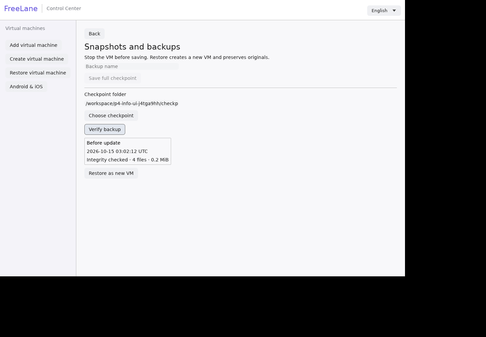
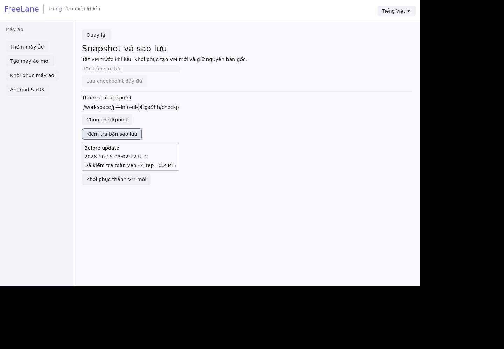

# Offline checkpoint and recovery-copy foundation

The CLI can create a full-copy checkpoint of a **stopped FreeLane workspace** and restore its verified files into a **new directory**. This is a first P1/P4 foundation, not a complete snapshot/backup product or evidence of successful Windows/BitLocker recovery.

```sh
freelane checkpoint-create /absolute/path/to/vm.toml /absolute/path/to/new-checkpoint 'Before app test'
freelane checkpoint-restore /absolute/path/to/checkpoint /absolute/path/to/new-recovery-workspace
freelane doctor-json /absolute/path/to/new-recovery-workspace/vm.toml
```

Creation holds the managed VM's backend lock and refuses running/paused VMs. Stop other tools using these files as well; the managed lock does not govern external processes. Only clean standalone qcow2 disks are currently supported; backing chains, external-data images and shared/hard-linked source files are refused. Sources must be inside the VM workspace. External installer media is not copied.

The copy includes the logical guest disk, firmware, NVRAM, configuration and bounded TPM files. qemu-img converts/compares disk data; copied files have SHA256 hashes. Checkpoint folders are private, files read-only and a marker prevents FreeLane from booting them directly. A verified recovery copy removes that marker only after publication. It is not an independent clone with regenerated guest identities; do not run it alongside the original until identity/network implications are resolved.

Files are staged in an owned private directory, then published with atomic no-replace rename. Existing directories, including empty ones created during a race, are never intentionally replaced. Failed operations discard their owned staging data; abrupt process/power interruption can leave a protected `.pending` directory. Automatic interruption repair/cleanup, full power-loss recovery, live/memory snapshots, UI management, incremental backup, archive import/export and clone identity handling remain outstanding.

Creation estimates destination capacity using measured qcow2 allocation plus firmware/state margin; it does not reserve disk space against other writers. Restore verifies file entries/checksums and rejects traversal, filename collisions, malformed manifests and existing output. It does not prove filesystem consistency, TPM sealing, driver compatibility or a successful guest boot. Run those acceptance checks before depending on the recovery copy.

## Verification scope

- Unit tests: active VM lock refusal, immutable startup marker, path traversal, overwrite protection and atomic publication against an existing empty directory.
- Real tool test: `python3 tests/checkpoint_real.py` uses a sparse 256 GiB virtual qcow2 file with patterns at its start and end with known bytes, fake nonbootable firmware and fake TPM state. It checks qemu-img conversion/compare, qemu-io data, checksums, corruption/overwrite refusal, source preservation and fresh-workspace restore. No guest OS or real TPM recovery runs.
- CI runs the file test on Debian/Linux and macOS with real qemu-img/qemu-io tools. Native file operations do not establish physical-Mac guest acceptance.
- Historical Windows test refusal before the allocation-measurement fix: the cloud filesystem is about 32 GiB with less than 1 GiB free, while the earlier conservative check required over 64 GiB. The check refused the operation before creating output. Use a sufficiently large destination for real Windows/Ubuntu restore acceptance; do not delete the existing guests or installation media to force this test.


## Ubuntu cloud guest acceptance

A signature/checksum-verified Ubuntu ARM64 cloud guest completed first boot and a reboot with an exact marker value preserved. After clean shutdown, its offline checkpoint was restored into a new workspace and booted; the same marker value was observed and the restored guest shut down cleanly. Original VM file hashes stayed unchanged during the restored boot. [Evidence](evidence/ubuntu-cloud-checkpoint-guest.json).

Checkpoint configurations detach installation media. For this NoCloud test, the original test seed was explicitly reattached using `settings-export` from the stopped source and `settings-import` on the restored VM; disk/firmware/NVRAM identity stayed with the restored target. External seed/ISO contents are not included in checkpoints. A cloud guest may need its original datasource reconnected; do not substitute seed contents or a new instance ID and assume unchanged guest identity. This Linux TCG check does not validate Windows protected storage/TPM or native Mac runtime.

## Thin backup allocation (newer than preview.16)

Backup creation now runs `qemu-img measure -f qcow2 -O qcow2 --output=json` and validates required/fully-allocated sizes. Free-space estimation uses the expected converted allocation, firmware/NVRAM lengths and 80 MiB allowance for bounded TPM/configuration/metadata, instead of the guest virtual capacity. A sparse256GiB disk with small patterns at both ends completed backup/restore with source hashes preserved, and existing overwrite/corruption refusal checks retained. This is an estimate, not a reservation; genuine insufficient space still refuses or fails safely. Windows protected-storage/TPM restore remains unaccepted.

## Inspect before restore

`freelane checkpoint-info /path/to/checkpoint` verifies the manifest, component hashes, standalone disk header and contained configuration before returning JSON metadata: label, creation time in UTC, guest type, component count and stored file bytes. The desktop verifies a chosen backup asynchronously and displays these details; editing its path clears the prior result. Verify backup checks a typed path. Restore independently verifies again before writing to a new destination.

Checksums establish point-in-time file integrity, not the authenticity of an externally supplied label/time or guest boot/TPM recovery. Even a forged manifest claiming guest_runtime_verified=true cannot promote inspection into runtime evidence.





[Evidence](evidence/backup-info.json).
