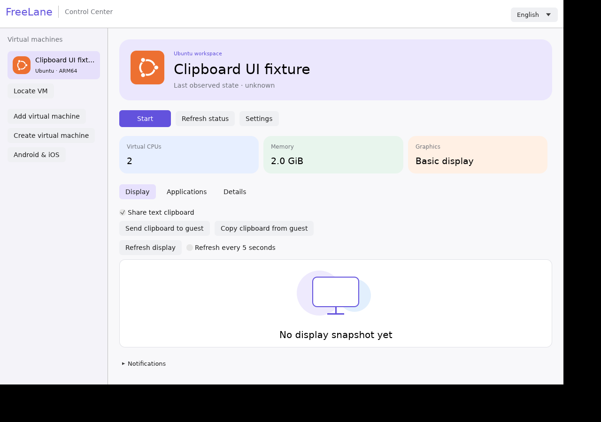

# Text clipboard between host and guest

Open a VM's **Display** tab, enable **Share text clipboard**, then use **Send clipboard to guest** or **Copy clipboard from guest**. Sharing defaults off and consent resets when a VM is opened. The first version transfers only when you press a button; automatic synchronization, images and rich text remain pending.

The guest needs an updated agent advertising `text_clipboard` with protocol v4 and an interactive graphical user session. Ubuntu Server without an X11/desktop session has no native GUI clipboard; use normal terminal copy/paste there. Install/update the Windows agent using [the verified lifecycle helper](agent-lifecycle.md).

Each transfer accepts up to 8 KiB of UTF-8 text, including Vietnamese/emoji, with bounded frames and source/sequence validation. Replayed incoming mutation requests are refused. Explicit reads can be copied again. Disabling sharing cancels a queued request before transmission, and responses received afterward do not overwrite the host clipboard. An already-transmitted operation cannot be undone. No mutation is retried automatically; clipboard payloads and guest-provided error text do not appear in routine notices/logs.

Linux clipboard ownership is retained while the manager is open. Actual tests covered the native agent and separate authenticated host/guest X11 displays through a private stdio/socket fixture. That establishes native clipboard/host UI transport behavior, not a running VM, Windows clipboard or native Mac acceptance. [Evidence](evidence/p2-lifecycle-clipboard.json).

