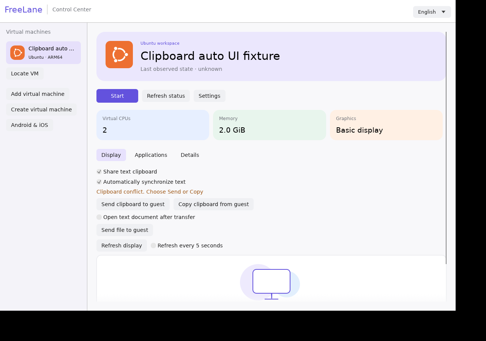

# Text clipboard between host and guest

Open a VM's **Display** tab, enable **Share text clipboard**, then use **Send clipboard to guest** or **Copy clipboard from guest**. Sharing defaults off and consent resets when a VM is opened. The prepared automatic mode additionally requires Automatically synchronize text, defaults off and is scoped to the selected VM. It is not published yet. Images and rich text remain pending.

The guest needs an updated agent advertising `text_clipboard` with protocol v4 and an interactive graphical user session. Ubuntu Server without an X11/desktop session has no native GUI clipboard; use normal terminal copy/paste there. Install/update the Windows agent using [the verified lifecycle helper](agent-lifecycle.md).

Each transfer accepts up to 8 KiB of UTF-8 text, including Vietnamese/emoji, with bounded frames and source/sequence validation. Replayed incoming mutation requests are refused. Explicit reads can be copied again. Disabling sharing cancels a queued request before transmission, and responses received afterward do not overwrite the host clipboard. An already-transmitted operation cannot be undone. No mutation is retried automatically; clipboard payloads and guest-provided error text do not appear in routine notices/logs.

Linux clipboard ownership is retained while the manager is open. Actual tests covered the native agent and separate authenticated host/guest X11 displays through a private stdio/socket fixture. That establishes native clipboard/host UI transport behavior, not a running VM, Windows clipboard or native Mac acceptance. [Evidence](evidence/p2-lifecycle-clipboard.json).

Automatic mode requires guest protocol v6 and polls every750ms when the serialized worker is free. Initially different content or observed edits on both sides pause until you choose Send/Copy. Guest restart/disconnect stops the mode until enabled again. The recipient rechecks the observed snapshot before applying; native APIs do not expose cross-process atomic clipboard CAS, so another app can still edit between final check and write.

142 workspace tests and11MCP tests passed; isolated native two-display and actual desktop tests used predefined synthetic strings only. Real Mac/Windows guest acceptance remains pending. Minor deferred: native host clipboard initialization failure retries at the polling interval instead of stopping.

