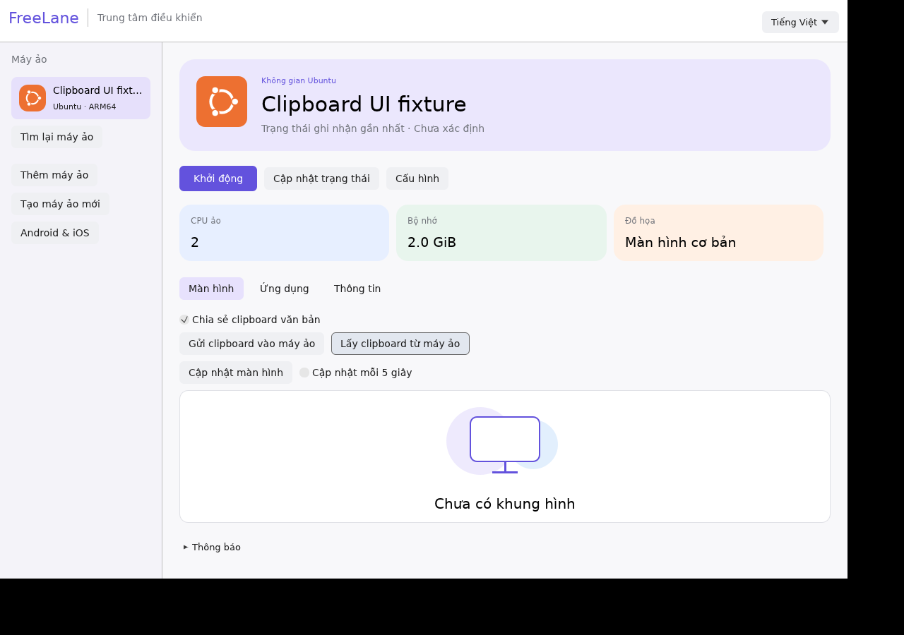

# Clipboard văn bản giữa máy chủ và máy ảo

Trong tab **Màn hình**, bật **Chia sẻ clipboard văn bản**, rồi bấm **Gửi clipboard vào máy ảo** hoặc **Lấy clipboard từ máy ảo**. Mặc định tắt; mỗi lần mở VM cần bật lại. Bản đầu chuyển khi anh bấm nút, chưa tự đồng bộ nền; ảnh và rich text vẫn để sau.

Guest cần agent mới có tính năng `text_clipboard` protocol v4 và phiên người dùng có giao diện. Ubuntu Server không có desktop/X11 thì không có clipboard GUI; dùng thao tác copy/paste bình thường của terminal. Agent Windows được cài/cập nhật bằng [bộ cài có xác minh checksum](agent-lifecycle.md).

Mỗi lần chuyển tối đa 8 KiB UTF-8, hỗ trợ tiếng Việt và emoji. Có giới hạn frame, kiểm tra nguồn/số thứ tự và từ chối gửi lặp. Có thể bấm lấy lại clipboard guest. Tắt chia sẻ sẽ hủy yêu cầu còn chờ trước khi gửi và ngăn phản hồi đến muộn ghi vào clipboard máy chủ; thao tác đã gửi thì không thể thu hồi. App không tự gửi lại khi lỗi, không đưa nội dung clipboard hoặc lỗi tùy ý của guest vào thông báo/log thường lệ.

Trên Linux, app giữ quyền sở hữu clipboard khi còn mở. Đã kiểm thử agent native và hai phiên X11 host/guest tách biệt qua fixture stdio/socket riêng; chưa phải kiểm thử VM đang chạy, clipboard Windows hay Mac thật. [Bằng chứng](evidence/p2-lifecycle-clipboard.json).

