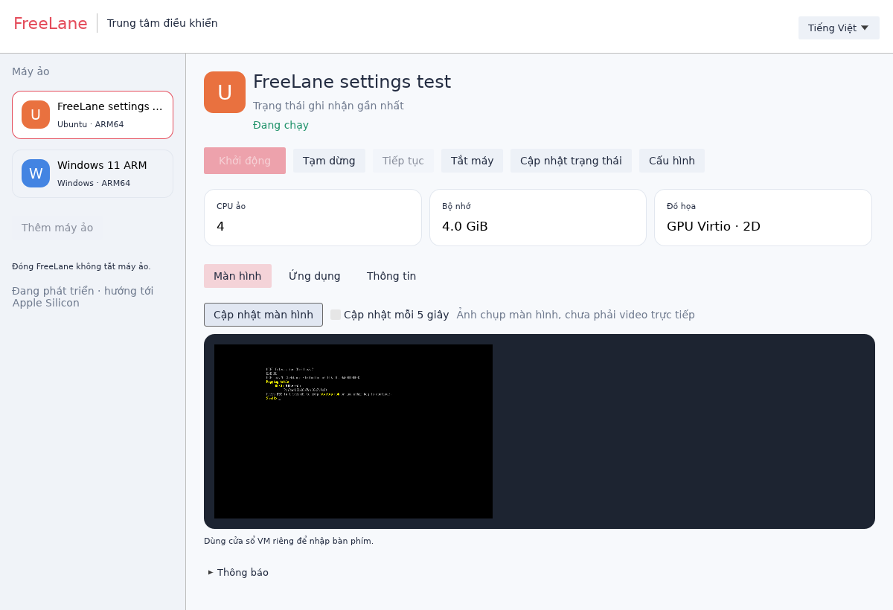
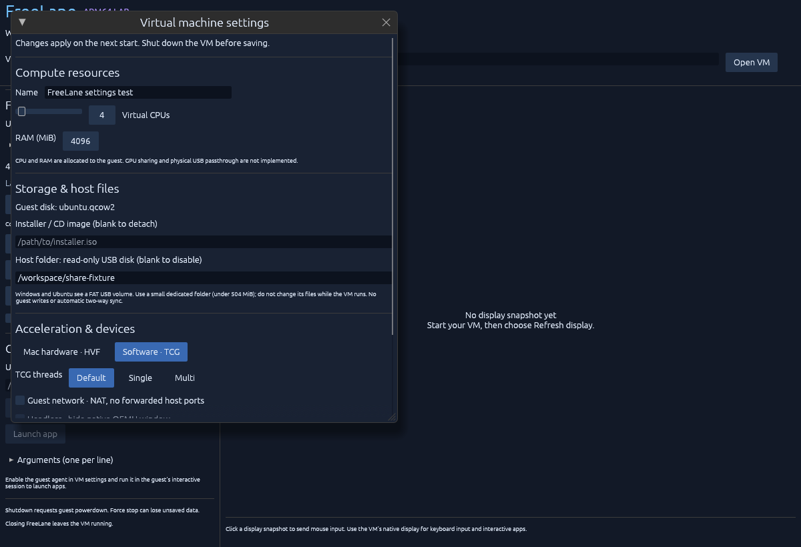
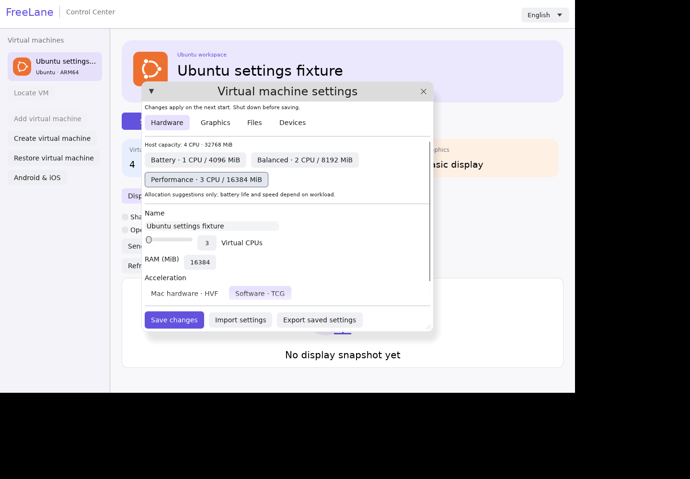
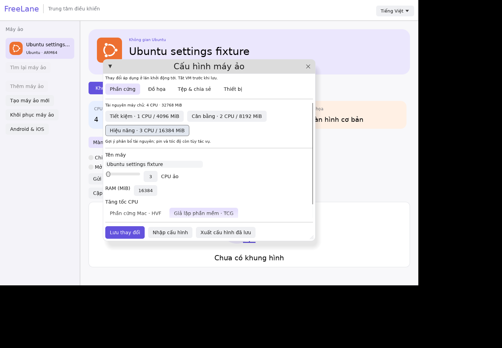
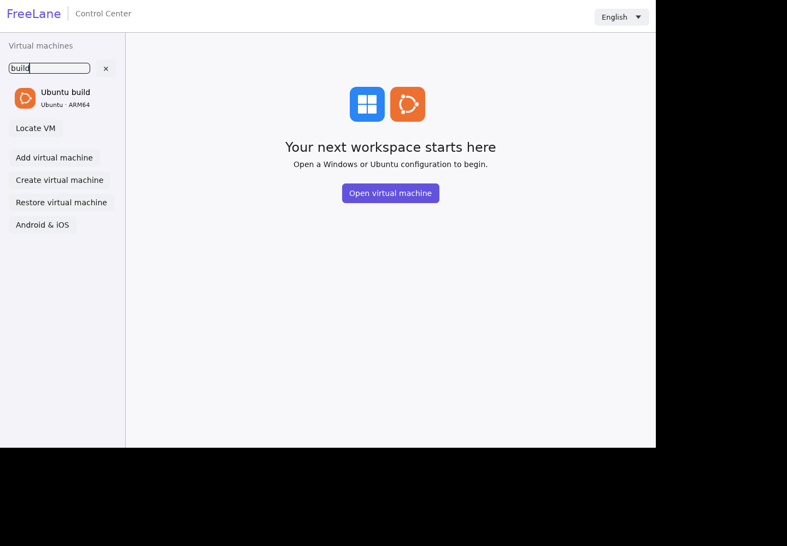

# Desktop control center

The desktop now uses a light theme, rounded VM cards, a machine library, resource summaries, and separate Display, Applications and Details pages. Settings is divided into Hardware, Graphics, Files and Devices. The design uses FreeLane branding and familiar VM-manager organization; it does not copy proprietary product assets.

## Language and VM library

Vietnamese is the default. Switch to English with the language menu at the upper right, or start with `--lang en`. DejaVu Sans is bundled for Vietnamese diacritics with its [font license](../crates/desktop/assets/DejaVu-LICENSE.txt).

```sh
cargo build --locked --workspace
./target/debug/freelane-desktop /absolute/path/to/ubuntu/vm.toml /absolute/path/to/windows/vm.toml --lang vi
```

Multiple supplied configurations populate the current session's library. Click a card to validate and open it; Add virtual machine opens a configuration-path dialog. New valid files are added to that session's library. This does not install an OS or persist a global VM inventory. Language selection is session-local; `--lang` chooses it at startup. Low-level QEMU/OS diagnostic details retain their original text.

Only one operation runs at a time. Switching machines is disabled while this manager owns a running supervisor or has a pending operation. Paths are canonicalized when opened; changing the dialog's text does not silently retarget active controls. The desktop needs the `freelane` CLI beside it, plus QEMU/swtpm where required by the selected profile.

## Display and lifecycle

Resource summaries describe configuration. Status is the last QMP observation, not a promise that the guest OS/app is ready. Start spawns the CLI supervisor with bounded, continuously drained stderr. Pause/Resume buttons follow the known state. Shutdown requests powerdown; refresh to check completion. Details → Advanced controls contains Force stop, which can lose unsaved data. Closing the manager leaves its VM running.

Display captures a real PPM frame in a private temporary directory with allocation/dimension limits. Optional refresh runs every five seconds through the same single worker and defaults to off. These are snapshots, not live video. Clicks use the actual fitted image rectangle, send bounded tablet coordinates only while status is running, and never automatically replay a press after a lost acknowledgment. Keyboard input uses QEMU's native window (`headless = false` on a host with a display). Ordinary idle UI does not enable the frame timer.

The content area scrolls at smaller window sizes; the supported minimum is 800 × 600. VM/library cards truncate long names. The actual UI was checked at 1200 × 820 and 800 × 600 with both Vietnamese and English.



The image records a disposable Ubuntu-profile EFI fixture, not an installed Ubuntu desktop or a native Mac session. Windows/Ubuntu installation evidence is separate in test-evidence.md and ubuntu.md.

## Configuration

Hardware edits name, vCPU count, RAM, HVF/TCG and TCG threading. Graphics chooses basic display or experimental Ubuntu Virtio GPU 2D and native-window visibility. Files controls ISO/NoCloud media and read-only USB or Ubuntu live read/write sharing. Devices controls NAT/network adapter, guest-agent/UART channels and exact physical USB selectors.

Save validates settings/device arguments, checks the runtime lock, detects conflicting on-disk text, creates a private backup and atomically replaces the file. Changes apply at the next start. Formatting/comments remain in the backup rather than the rewritten TOML. Firmware, TPM, guest disk and storage controller are preserved. See [sharing instructions](sharing.md) and [graphics evidence](graphics.md).



## Apps and verification limits

Applications uses the bounded guest-agent transport. Executable paths and one argument per line are passed literally without an implicit shell. Install/run the agent in the guest first. A PID response only reports process start; observe the actual guest window/workload to verify behavior. A timeout is not automatically retried, and execution outcome can be unknown.

The redesign was exercised on authenticated Linux Xvfb. GPU/headless settings were saved through the actual form and independently checked on disk. Start/Pause/Resume produced independently queried QMP `running`/`paused`/`running` states in a disposable EFI VM. Refresh display showed its genuine firmware shell. Vietnamese diacritics and English switching rendered correctly. Workspace build, format/Clippy, 47 portable Rust tests, two EFI media/profile tests and macOS ARM64 cross-check passed; a separate real Linux GPU fixture checked scanout pixels. Four other opt-in QEMU tests were not rerun for this change. Native Mac GUI execution, accelerated 3D and Windows graphics drivers remain unverified/unimplemented as described in graphics.md.

## Mobile devices

Use **Android & iOS** in the sidebar, or `freelane-desktop --mobile /absolute/path/to/mobile.toml`. Click Open to load an existing Android AVD/Xcode Simulator profile. The mobile panel operates separately from the selected Windows/Ubuntu VM; SDK errors do not replace VM state. It supports install, launch and PNG snapshots; scroll to see the complete phone frame. iOS requires Mac/Xcode and Simulator builds. See [mobile setup, evidence and known cloud ANR](mobile.md).

## Resource allocation presets

Hardware settings offer Battery, Balanced and Performance CPU/RAM suggestions with visible values. They reserve one available host CPU and2GiB RAM, keep Windows2CPU/4GiB and Ubuntu1CPU/2GiB minima, and respect configuration maxima. They change only the draft; Save requires the VM stopped and applies at its next start. Other settings and files remain unchanged. These are allocation suggestions, not measured energy/speed improvements or live CPU quotas.

Capacity means physical/detected capacity, not free memory or a reservation; other VMs/apps still consume resources. Unknown Linux cgroup membership/mount layouts disable suggestions and leave manual controls available. Small hosts may show disabled presets because guest minimums plus the host reserve cannot fit.





[Owned UI and test evidence](evidence/resource-presets.json). Native Mac memory pressure/battery and multi-VM policies remain pending.

## Find a virtual machine

The library search matches VM names or Windows/Ubuntu guest types, trims surrounding whitespace and ignores letter case, including Vietnamese uppercase/lowercase. It preserves bookmarks and the selected VM. Clear the field with × to show the full library. Search is session-only and does not remove accents.




