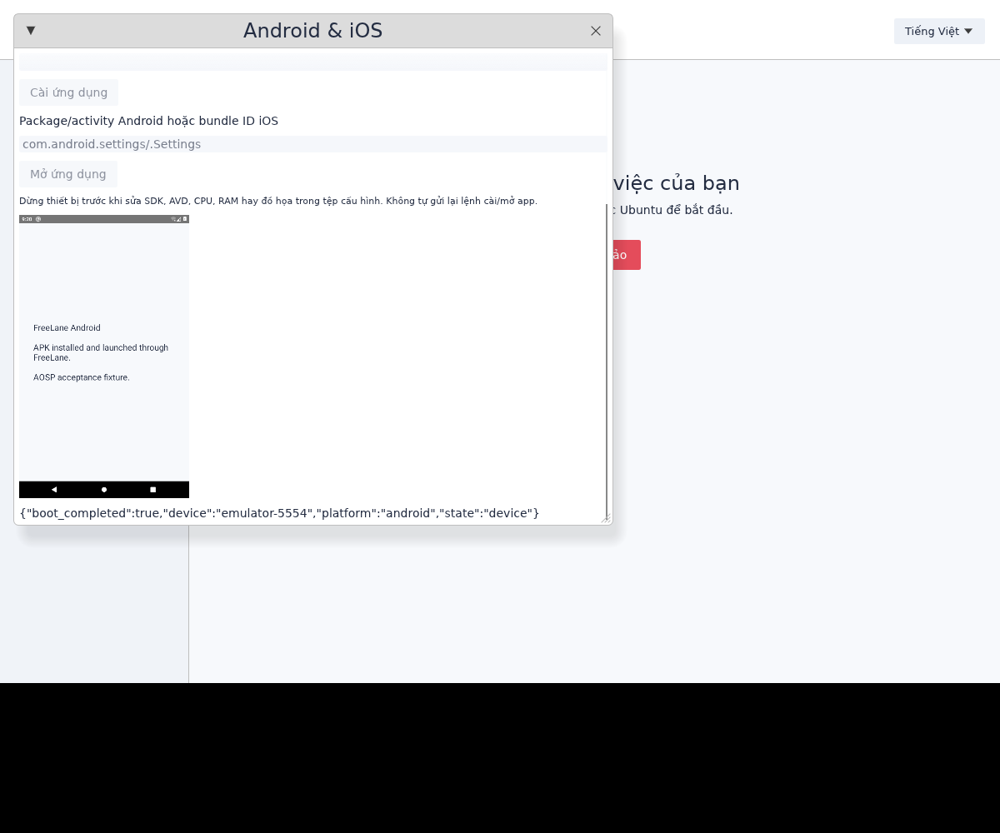
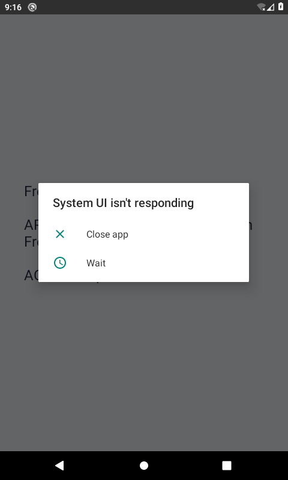
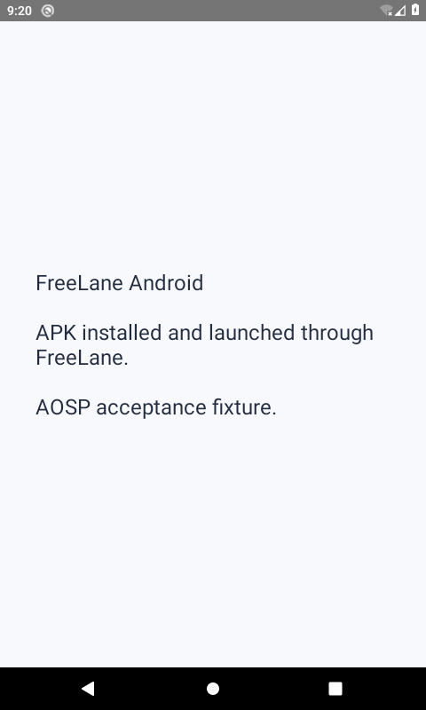

# Android and iOS devices

FreeLane can manage an existing **Android SDK Emulator AVD** or an **Apple Xcode iOS Simulator** alongside its Windows/Ubuntu VMs. These use their official SDK backends, separately from the QEMU ARM desktop backend. The mobile panel, CLI and MCP support starting, inspecting, stopping, installing an application, launching it and taking a genuine PNG snapshot. They do not provide continuous video, touch/keyboard forwarding, automatic SDK installation on Mac, or universal application compatibility.

## Android on Mac

Install Android Studio and its SDK/Emulator through Google's supported installer. In Device Manager, create and boot an AVD that matches your host; use an **ARM64** system image on Apple Silicon. Copy [the Android profile](../configs/mobile.android.example.toml), set the actual SDK root and AVD name, and choose a free even console port. Different profiles need different ports. Hardware acceleration is the default; FreeLane does not silently fall back to software emulation. `gpu="auto"` delegates rendering selection to the SDK. `host` requests host rendering; `software`/`swiftshader` request software rendering. Their availability depends on your SDK version and host, and does not mean Apple GPU passthrough.

Use recent SDK Platform Tools supporting `adb install --no-incremental`. An APK must contain code compatible with the AVD's ABI/API and any services it needs. The cloud AOSP fixture has **no Play Store or Google Play Services**. ARM-only APKs cannot be assumed to work on an x86 AVD. Copy SDK images only under their respective license terms; FreeLane does not bundle Google's binaries or accept SDK licenses for you.

```sh
./target/debug/freelane mobile-plan /absolute/path/to/mobile.android.toml
# Foreground supervisor; use another terminal for subsequent commands.
./target/debug/freelane mobile-start /absolute/path/to/mobile.android.toml
./target/debug/freelane mobile-wait /absolute/path/to/mobile.android.toml
./target/debug/freelane mobile-install /absolute/path/to/mobile.android.toml '/absolute/path/to/My App.apk'
./target/debug/freelane mobile-launch /absolute/path/to/mobile.android.toml com.example.app/.MainActivity
./target/debug/freelane mobile-capture /absolute/path/to/mobile.android.toml /absolute/path/to/new-frame.png
./target/debug/freelane mobile-stop /absolute/path/to/mobile.android.toml
```

`mobile-devices` lists SDK AVD names. `mobile-status` checks the exact AVD at the configured port and Android's `sys.boot_completed`. Boot completion and `am start` success do not establish a healthy UI. Capture and inspect the application separately. Paths and application identifiers are passed as literal arguments. Installs and launches are not automatically retried. On timeout, inspect the device before issuing another mutation. Profiles and screenshots are size bounded; capture refuses an existing destination. Startup does not wipe userdata or load snapshots.

## iOS on Mac

iOS support is an **Xcode Simulator adapter**, requiring a real Mac, full Xcode, an installed Simulator runtime and an available device. It cannot run on this Linux cloud. It installs a **Simulator-target `.app` build**, not an App Store `.ipa`, and does not emulate arbitrary iPhone apps. A Simulator build differs from a physical iPhone build even on ARM64. Camera, cellular, device-only APIs and other hardware behavior may require real devices.

Copy [the iOS profile](../configs/mobile.ios.example.toml), obtain an available device UUID with `xcrun simctl list devices available`, and replace the placeholder UUID. An optional `developer_dir` selects Xcode without changing the system's active developer directory. Exact UUIDs are required; `all` and `booted` aliases are rejected.

```sh
./target/debug/freelane mobile-start /absolute/path/to/mobile.ios.toml
./target/debug/freelane mobile-wait /absolute/path/to/mobile.ios.toml
./target/debug/freelane mobile-window /absolute/path/to/mobile.ios.toml
./target/debug/freelane mobile-install /absolute/path/to/mobile.ios.toml '/absolute/path/to/Simulator Build.app'
./target/debug/freelane mobile-launch /absolute/path/to/mobile.ios.toml com.example.app
./target/debug/freelane mobile-capture /absolute/path/to/mobile.ios.toml /absolute/path/to/new-ios.png
./target/debug/freelane mobile-stop /absolute/path/to/mobile.ios.toml
```

`mobile-status` reports the Simulator's state, with a reminder to use `mobile-wait` (`simctl bootstatus -b`) for OS readiness. This implementation and the desktop compile for macOS ARM64, but **iOS runtime operation has not been verified on a Mac**. Linux tests cover argument construction and the explicit unsupported-host error.

## Desktop and MCP

Choose **Android & iOS** in the sidebar, or start with `freelane-desktop --mobile /absolute/path/to/mobile.toml`. Click **Open / Mở** to load that configuration. The panel has status, shutdown, capture, install and launch actions, and a native Simulator-window action for iOS. Scroll down to see the entire captured phone frame. Edit the profile while stopped to change SDK, AVD, CPU, RAM, acceleration or GPU settings. Mobile errors do not replace the selected Windows/Ubuntu VM state. Closing the manager leaves its SDK emulator running; shut it down explicitly before saving a cloud snapshot.



For MCP, add only existing profiles to `[mobile_devices]` in your trusted server config. See [the example](../configs/mcp.mobile.example.toml) and [client connection guide](mcp.md). VM and mobile registries can coexist. Mobile calls select registered names rather than arbitrary profile paths:

| Tool | Arguments / behavior |
| --- | --- |
| `mobile_control` | `device`, `action`: start, status, stop, devices, window (iOS only) |
| `mobile_install` | `device`, absolute `application` APK or Simulator `.app` path |
| `mobile_launch` | `device`, `application` package/activity or bundle identifier |
| `mobile_capture` | `device`; PNG image plus retained artifact path |

Starting returns a request, not OS readiness. Poll status and check actual behavior. Closing a client leaves the device running. The server has 14 tools, no arbitrary shell interface, and no remote Mac provisioning.

## Linux cloud evidence and known failure

The verified SDK fixture uses Google Emulator **37.2.12**, Platform Tools **37.0.1**, AOSP Android **10 / API 29 x86 r08**, one emulated CPU, 2048 MiB RAM and SwiftShader. This cloud has **no `/dev/kvm`**. TCG software CPU emulation is slow; it is not a Mac performance result. Both 720×1280 and 480×800 boots showed **“System UI isn't responding”**. Reduced resolution did not eliminate the ANR. The unrecovered acceptance check failed because the app was obscured, despite successful install/launch commands.



After manually choosing **Wait** once on the 480×800 guest, the strengthened acceptance test installed our locally built signed APK through real stdio MCP, launched it, checked the foreground activity **and focused window**, found no current ANR dialog, and captured the actual app. [The report](evidence/android-recovered-acceptance.json) records this manual recovery. This is one successful observation after recovery, **not a stable Android runtime or a fix for the System UI failure**. The measured launch took about 20 seconds under software emulation. Native Mac hardware acceleration and sustained Android/iOS stability remain unverified.



Reproduce the dedicated Linux fixture without touching existing userdata:

```sh
python3 scripts/setup-android-cloud.py \
  --sdk-root /workspace/.freelane-tools/android-sdk \
  --cache /workspace/.freelane-tools/android-downloads \
  --fixture /workspace/android-preview \
  --user-home /workspace/.freelane-tools/android-home
```

The script is pinned to Linux x86_64, checks HTTPS archive sizes/SHA-256, refuses SDK changes while its tools are running, and preserves an existing AVD/profile. It also installs API29/build-tools35 for the acceptance fixture. It requires Python3.11+, curl and standard Linux runtime libraries; APK building additionally requires a JDK with `jdk.compiler` and `keytool`. It does not install SDK images for Mac or fabricate license acceptance.

```sh
python3 scripts/build-android-smoke.py --sdk-root /workspace/.freelane-tools/android-sdk \
  --output /workspace/freelane/target/android-smoke
# Start the fixture in a separate terminal, wait for boot, then run:
python3 tests/mobile_real_smoke.py --profile /workspace/android-preview/mobile.toml \
  --apk '/workspace/freelane/target/android-smoke/FreeLane smoke & app.apk' \
  --output /absolute/path/to/new-report.json --image /absolute/path/to/new-app.png
```

The test fails on a wrong foreground/focused window or a current error/ANR dialog. If manual recovery was necessary, record it with `--recovery-note`; this flag never disables health assertions. Test signing credentials and APKs remain under ignored `target/`; do not commit private ADB keys, signing keys or SDK userdata. The retained Android fixture is stopped after testing with its userdata preserved.
