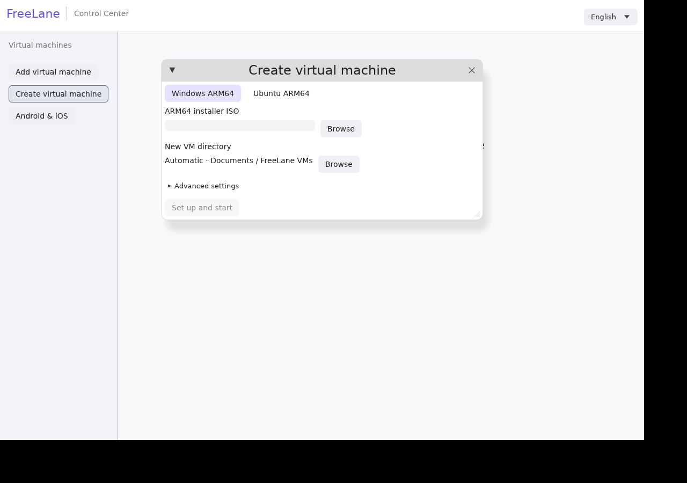

# Set up Windows or Ubuntu

1. Open **Create virtual machine**.
2. For **Windows ARM64**, choose your Windows ARM64 ISO. For **Ubuntu ARM64**, choose an Ubuntu Server LTS version; FreeLane downloads the official ARM64 installer.
3. Keep the automatic Documents location or choose a folder on a mounted external drive.
4. Click **Set up and start**. FreeLane installs missing host tools, prepares a fresh VM and starts its installer. Complete the OS/account prompts inside the VM.

CPU, RAM, virtual disk capacity, custom firmware and cloud-image import are in **Advanced settings**. Normal setup uses defaults. The virtual disk grows with written data; creation does not reserve its whole capacity. Storage is not pooled across drives. Actual OS/application data still needs space on the selected drive.

On Mac, setup uses Homebrew to install QEMU, swtpm, 7-Zip and GnuPG. If Homebrew is missing, the app launches its bundled, pinned official installer in Terminal, then installs those tools automatically. macOS can require administrator, developer-tools or automation prompts; credentials stay in the system UI. Existing Homebrew installations run component installation in the background. The app package embeds the bootstrap and verification keyring; backend binaries are downloaded during setup. Android SDKs and Xcode/iOS runtimes use their separate device setup.

Ubuntu downloads use HTTPS, the bundled Ubuntu CD-image signing keyring, the signed SHA256 manifest and an exact ISO checksum before ARM64 media inspection. Downloaded media stays in a private folder beside the VM on the selected storage; keep it until ejected from the VM. Windows ISO paths remain where you selected them. Automatic downloading of Windows is not included.

Cancel stops owned downloads/background installation jobs. If a Terminal bootstrap is already open, close that installation tab to stop it. Cancellation during workspace finalization can leave a complete stopped VM, which can be opened later. The manager does not stop already-running VMs when closed.

Disconnected volumes are refused. Downloads and creation pin directory handles and check filesystem identity; existing files are preserved. Storage must support a private folder. Native Mac Homebrew/HVF and physical external-drive detach acceptance remain pending.

