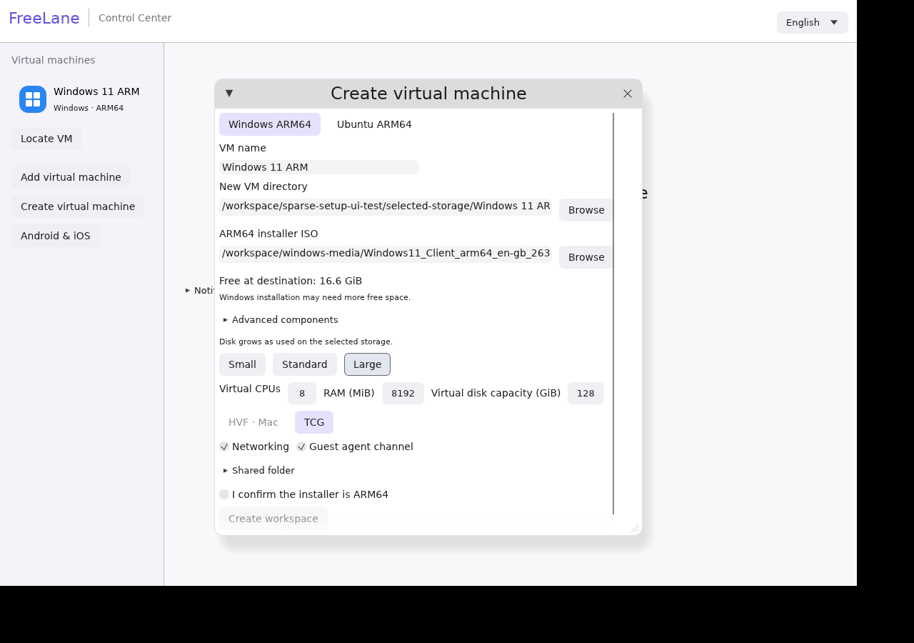

# Create a Windows or Ubuntu VM

1. Open **Create virtual machine**, select the OS and choose your ARM64 installer ISO (or Ubuntu cloud image).
2. Choose a folder on the host or a mounted external SSD. The wizard selects a fresh VM name without replacing existing files. Where needed and supported, folder selection prepares a private `FreeLane VMs` container; selecting a folder can therefore leave an empty container if you cancel.
3. Check **Free at destination**, then choose CPU, RAM and **Virtual disk capacity**. QEMU/firmware paths are discovered; Homebrew installation is available from the wizard when needed. Technical paths stay in **Advanced components**.
4. Confirm ARM64 and create the workspace. Start the VM afterward to install the guest OS.

The qcow2 disk grows as data is written. A 128 GiB virtual disk does not need 128 GiB free to create; its maximum is the capacity seen by the guest. The app checks initial metadata/firmware space rather than reserving the virtual maximum. Windows still requires at least a 64 GiB virtual disk. The former 4 TiB application cap is removed; checked byte representation and QEMU/format limits still apply.

VM files live on the selected storage. A shared folder gives the guest access to host files and does not relocate its VM disk. The selected ISO remains at its original path. Leave space for actual OS/application data: creating a profile with little free space does not establish that Windows installation will fit. Storage is not pooled automatically across different drives; if the selected drive fills up, writes can fail.

Ubuntu cloud import needs room for the source snapshot and conversion. Its conservative check uses source virtual capacity, source-file bytes and metadata, not the enlarged target maximum. Checkpoint/restore-copy capacity checks are separate and unchanged.

Disconnected external volumes are refused. Creation holds the selected directory open, checks identity and publishes without replacement. Use storage that supports a private folder; publicly writable non-sticky ancestor directories are refused. Physical Mac/HVF and real SSD disconnect acceptance remain pending.

Portable evidence: 128 GiB Windows workspace created through the real Linux UI with 16.7 GiB free; initial disk allocation 200,704 bytes. Real QEMU also created an 8 TiB virtual disk with less than 64 MiB allocated. These checks did not install or boot Windows. [Evidence](evidence/sparse-setup.json).
