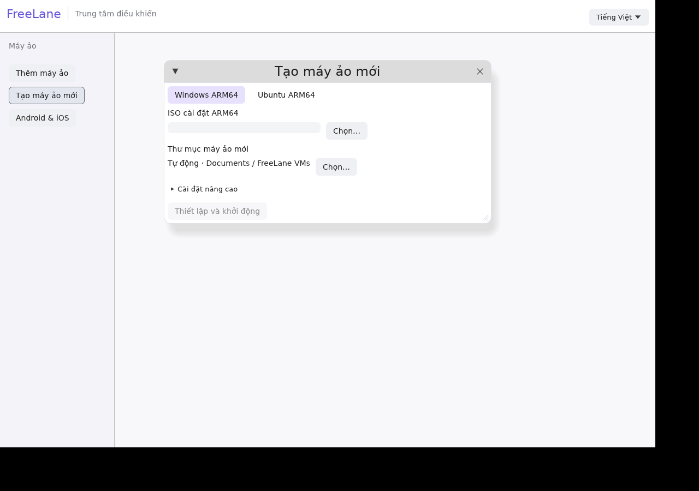

# Thiết lập Windows hoặc Ubuntu

1. Mở **Tạo máy ảo mới**.
2. Với **Windows ARM64**, chọn ISO Windows ARM64. Với **Ubuntu ARM64**, chọn phiên bản Ubuntu Server LTS; FreeLane tự tải bộ cài ARM64 chính thức.
3. Giữ nơi lưu tự động trong Documents hoặc chọn thư mục trên ổ ngoài đã kết nối.
4. Bấm **Thiết lập và khởi động**. App tự cài công cụ còn thiếu, tạo máy ảo mới rồi mở trình cài đặt. Hoàn tất tài khoản và các bước cài hệ điều hành trong máy ảo.

CPU, RAM, dung lượng đĩa ảo, firmware riêng và nhập ảnh cloud nằm trong **Cài đặt nâng cao**. Luồng thông thường dùng cấu hình mặc định. Đĩa tăng theo dữ liệu ghi, không giữ trước toàn bộ dung lượng tối đa. App không gộp dung lượng nhiều ổ; hệ điều hành và ứng dụng vẫn cần chỗ trống trên ổ đã chọn.

Trên Mac, setup dùng Homebrew để cài QEMU, swtpm, 7-Zip và GnuPG. Nếu chưa có Homebrew, app mở bộ cài chính thức đã đóng gói và cố định phiên bản trong Terminal, rồi tự cài các công cụ. macOS có thể yêu cầu quyền quản trị, công cụ phát triển hoặc quyền điều khiển Terminal; mật khẩu được nhập trong giao diện hệ thống. Khi đã có Homebrew, phần cài công cụ chạy nền. Bộ cài bootstrap và keyring xác minh nằm trong app; các binary backend được tải lúc setup. Android SDK và Xcode/runtime iOS vẫn dùng phần thiết lập thiết bị riêng.

Ảnh Ubuntu được tải qua HTTPS, xác minh chữ ký bằng keyring Ubuntu CD-image đóng gói sẵn, kiểm tra SHA256 đúng tên ISO rồi kiểm tra bộ nạp ARM64. Ảnh tải nằm trong thư mục riêng cạnh máy ảo trên ổ đã chọn; giữ ảnh đến khi tháo ISO khỏi VM. ISO Windows nằm ở đường dẫn anh đã chọn; app chưa tự tải Windows.

Hủy sẽ dừng tiến trình tải/cài nền thuộc app. Nếu bootstrap đã mở trong Terminal, đóng tab cài đặt đó để dừng. Hủy lúc hoàn tất workspace có thể để lại máy ảo đầy đủ nhưng chưa chạy; có thể mở lại sau. Đóng trình quản lý không dừng các VM đang chạy.

Ổ mất kết nối bị từ chối. Tải và tạo VM giữ handle thư mục, kiểm tra định danh filesystem và giữ nguyên file có sẵn. Nơi lưu phải hỗ trợ thư mục riêng. Kiểm thử Homebrew/HVF trên Mac thật và tháo ổ ngoài vật lý vẫn còn chờ.

[Bằng chứng kiểm thử setup](evidence/quick-setup.json) · [Xác minh gói Mac đã publish](evidence/release-preview10.json).
