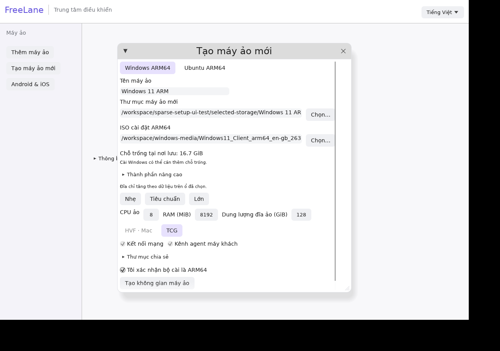

# Tạo máy ảo Windows hoặc Ubuntu

1. Mở **Tạo máy ảo mới**, chọn hệ điều hành và ISO ARM64; Ubuntu có thể dùng ảnh cloud.
2. Bấm **Chọn…** tại thư mục máy ảo, chọn nơi lưu trên Mac hoặc SSD ngoài đang kết nối. App chọn tên VM mới, không ghi đè dữ liệu có sẵn. Khi cần và hệ thống hỗ trợ, app chuẩn bị thư mục riêng `FreeLane VMs`; nếu hủy, thư mục trống này có thể còn lại.
3. Xem **Chỗ trống tại nơi lưu**, chọn CPU, RAM và **Dung lượng đĩa ảo**. QEMU/firmware được tự tìm; có nút cài thành phần qua Homebrew nếu cần. Đường dẫn kỹ thuật nằm trong **Thành phần nâng cao**.
4. Xác nhận ARM64 rồi tạo. Tạo xong mới khởi động VM để cài hệ điều hành.

Đĩa qcow2 chỉ tăng theo dữ liệu được ghi. Chọn đĩa ảo 128 GiB không có nghĩa phải trống 128 GiB ngay lúc tạo. App kiểm tra chỗ cho metadata/firmware ban đầu, không giữ trước toàn bộ dung lượng tối đa. Windows vẫn cần đĩa ảo tối thiểu 64 GiB. Đã bỏ trần 4 TiB của app; kiểu dữ liệu và QEMU/định dạng vẫn có giới hạn kỹ thuật.

File VM nằm trên ổ chứa thư mục đã chọn. **Thư mục chia sẻ** cho guest truy cập file host, không chuyển đĩa VM sang ổ đó. ISO giữ nguyên ở vị trí nguồn. Dung lượng OS/app ghi thực tế vẫn cần chỗ trống; tạo được VM không có nghĩa cài Windows chắc chắn đủ chỗ. App không tự ghép dung lượng nhiều ổ; khi ổ đích đầy, việc ghi có thể lỗi.

Nhập ảnh Ubuntu cloud cần chỗ cho bản nguồn riêng và chuyển đổi. Kiểm tra bảo thủ tính dung lượng ảo của ảnh nguồn, số byte file nguồn và metadata; không đòi chỗ bằng dung lượng tối đa mới. Kiểm tra dung lượng cho checkpoint/khôi phục bản sao vẫn riêng và chưa thay đổi.

App từ chối ổ ngoài mất kết nối, giữ tham chiếu thư mục khi tạo và kiểm tra lại nơi lưu trước khi hoàn tất. Nơi lưu cần hỗ trợ thư mục riêng; thư mục cấp trên cho người khác quyền đổi dữ liệu không được dùng. Kiểm thử Mac/HVF và tháo SSD vật lý còn chờ máy thật.

Đã tạo workspace Windows 128 GiB qua UI Linux thật khi còn 16,7 GiB trống; file đĩa ban đầu chiếm 200.704 byte. QEMU thật cũng tạo được đĩa ảo 8 TiB với phần lưu trữ vật lý dưới 64 MiB. Đây là kiểm thử tạo workspace, chưa cài hoặc boot Windows. [Bằng chứng](evidence/sparse-setup.json).
