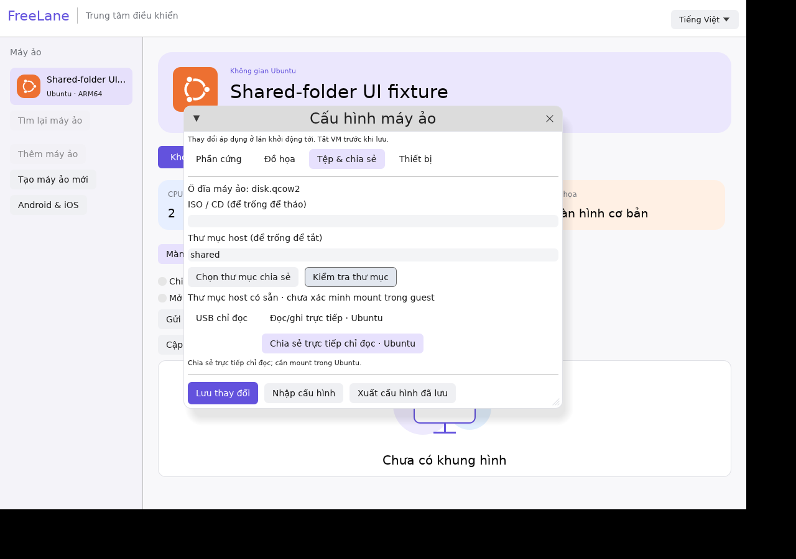

# Chia sẻ thư mục

Trong Cấu hình → Tệp & chia sẻ, có ba chế độ:

- USB chỉ đọc: Windows/Ubuntu, dùng FAT16; giữ thư mục nguồn dưới khoảng504MiB và không đổi lúc VM chạy.
- Đọc/ghi trực tiếp: Ubuntu9p, guest có thể sửa file host.
- Chia sẻ trực tiếp chỉ đọc: Ubuntu9p, QEMU chặn ghi ở backend; thay đổi host vẫn đọc được ngay, không có giới hạn FAT504MiB.

Bấm Chọn thư mục chia sẻ và Kiểm tra thư mục. App không tạo lại thư mục đã mất. Nếu ổ/thư mục không còn sẵn sàng, kết nối lại hoặc chọn nguồn mới, tắt VM rồi lưu và khởi động lại. Trạng thái kiểm tra chỉ xác nhận thư mục host; chưa xác nhận guest mount.

Mount9p chỉ đọc trong Ubuntu:

```sh
sudo mkdir -p /mnt/freelane
sudo mount -t 9p -o ro,trans=virtio,version=9p2000.L,cache=none freelane /mnt/freelane
```

Không tự cấp quyền sudo trong guest. Windows chưa có backend mount trực tiếp9p; có thể dùng chuyển file qua agent hoặc USB chỉ đọc.

Đã kiểm thử guest ARM: guest root không thể tạo/ghi đè/đổi tên/xóa file ở chế độ chỉ đọc; host sửa thì guest đọc được. Chế độ đọc/ghi cũ cũng đã kiểm thử lại. Kiểm thử ổ ngoài và mount trên Mac thật vẫn chờ.

Sau nhập cấu hình, bấm Kiểm tra thư mục lại vì trạng thái cache có thể còn thuộc nguồn cũ. Thông báo chặn9p trên Windows hiện vẫn dùng chữ đọc/ghi cho cả hai chế độ.


