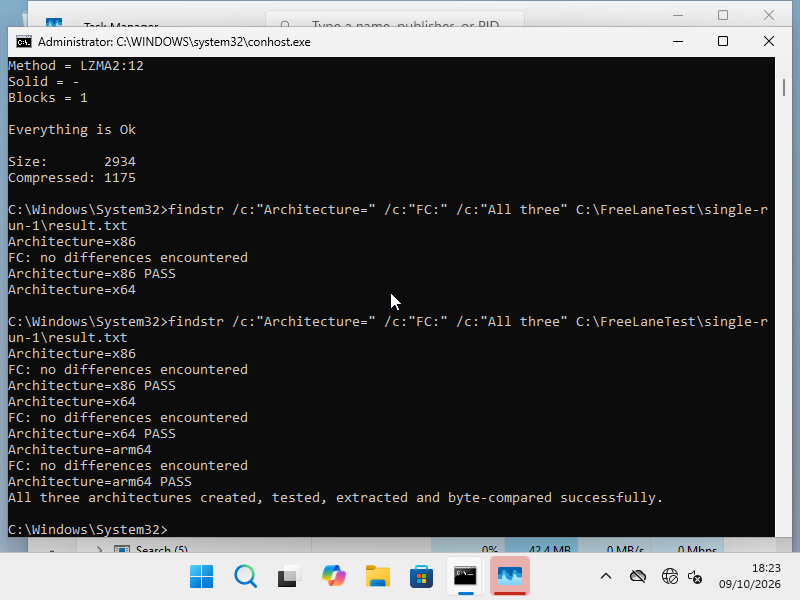
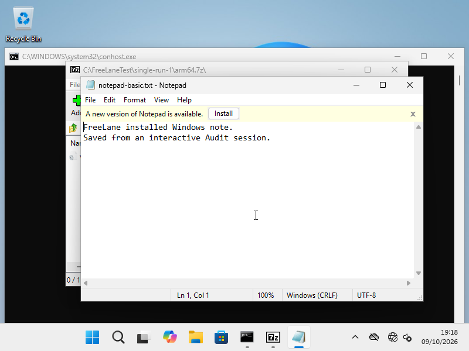

# Recorded Windows ARM test evidence

These are real captures from the Linux cloud experiment on 2026-10-09 UTC, retained unchanged as PNG files. They document specific operations, not a live preview or a release certification. No Windows image, guest disk, third-party executable, driver package or memory dump is included in the repository.

## Installed guest connection and application launch

The installed Windows 11 ARM Home Single Language build 26300.9457 ran in its interactive Audit session. QEMU 10.0.13 used `virt-10.0`, 4 guest CPUs, 4096 MiB RAM, an NVMe qcow2 disk, `ramfb`, USB keyboard/tablet and persistent NVRAM/TPM state. Networking was disabled. The integration profile used explicit multithreaded TCG with `guest_agent=true`; this is software emulation, not HVF.

Normal Windows PnPUtil staged the ARM64 vioserial package as `oem1.inf` with exit code 0. After a clean cold boot, the agent was started manually in the interactive session. A fresh host ping returned Windows/aarch64; the FreeLane GUI also received that response. A literal host launch opened official 7-Zip 25.01 ARM64 with the saved `C:\FreeLaneTest\single-run-1\arm64.7z`. The archive contained the intended 2934-byte `vioser.inf`; its GUI Test subsequently reported “There are no errors”. No service, automatic startup or signature-enforcement bypass was used.


The .exe path shown in this connection screenshot is placeholder text. This capture demonstrates the ping and archive window; it is not evidence that its disabled Launch button launched Notepad. The later Notepad test entered an actual executable path before requesting launch.

## Three executable architectures

The earlier single-threaded TCG profile used the same guest CPU and memory resources. The official 7-Zip 25.01 extra package supplied x86, x64 and ARM64 console executables. `scripts/windows-archive-smoke.cmd` created, tested and extracted one archive per architecture, then used native `fc /b` against the source file. All three explicit PASS markers, three “FC: no differences encountered” lines and the final all-three success line were observed in the native transcript.



The final numeric batch `AcceptanceExitCode` was not captured, so this record does not claim that observed numeric result. Older extracted x86 bytes separately matched their source after reboot with `PersistCompareExitCode=0`. The new ARM64 archive was opened and CRC-tested in the integration profile after another reboot. Post-reboot byte comparisons of every new output are not established.

## Notepad editing, saving and reopening

The FreeLane GUI launched `C:\Windows\System32\notepad.exe` in the installed Audit session. Diagnostic CLI keyboard controls entered two lines. The actual Save As dialog saved a new `C:\FreeLaneTest\notepad-basic.txt`; the saved title was observed before the window was closed. A fresh literal agent launch with that filename reopened Notepad and visibly retained both lines.



This verifies saving and reopening within one installed session. Notepad persistence after another guest reboot, normal user setup, direct GUI keyboard forwarding and native Mac operation remain unverified. Windows was subsequently shut down using its native `shutdown.exe`; QEMU and swtpm exited, and the local manager/display were stopped. No guest hard-stop was needed for this final shutdown.

## Known failure and remaining gates

An earlier installed trial recorded kernel bugcheck `0x139`, first parameter `3`, during a byte-comparison attempt. Offline Windows DbgEng inspection found `nt` and `WdFilter` frames; their presence does not establish the cause. The later passing trial does not prove that switching TCG threading fixed the failure, especially because firmware ROM lookup and integration devices also changed between profiles.

Secure Boot returned `True` in native Windows diagnostics, but `Get-Tpm` failed with `0x80284001`; installed TPM readiness is not verified. Guest networking, stable everyday use, normal user setup, Mac HVF execution, accelerated Windows graphics, seamless application windows and any performance advantage over Parallels remain open gates. All-application compatibility cannot be inferred from these workloads.

Portable Rust tests and the five separately invoked ARM/QEMU integration tests exercise the host implementation. Those five tests boot ARM/UEFI fixtures, not Windows; they do not replace the manual Windows experiments above. GitHub Actions results must be checked separately after a push.

## Capture checksums

SHA-256 identifies the files in this record; it does not independently authenticate the runtime claims.

```text
989226f1d4403623f31c5a06f0c1f3d9a5aab7e91c30ed35468e5d9a6f72c5ad  archive-three-architectures.png
2e3c3cda2c11a747d1101018a53ace07543499c5d64d47bff3078b083578c02c  installed-guest-connection.png
e66b2c65167e7557aa632a64941f5eb3b48ef320764da19898db5d062b45b314  notepad-save-reopen.png
```
