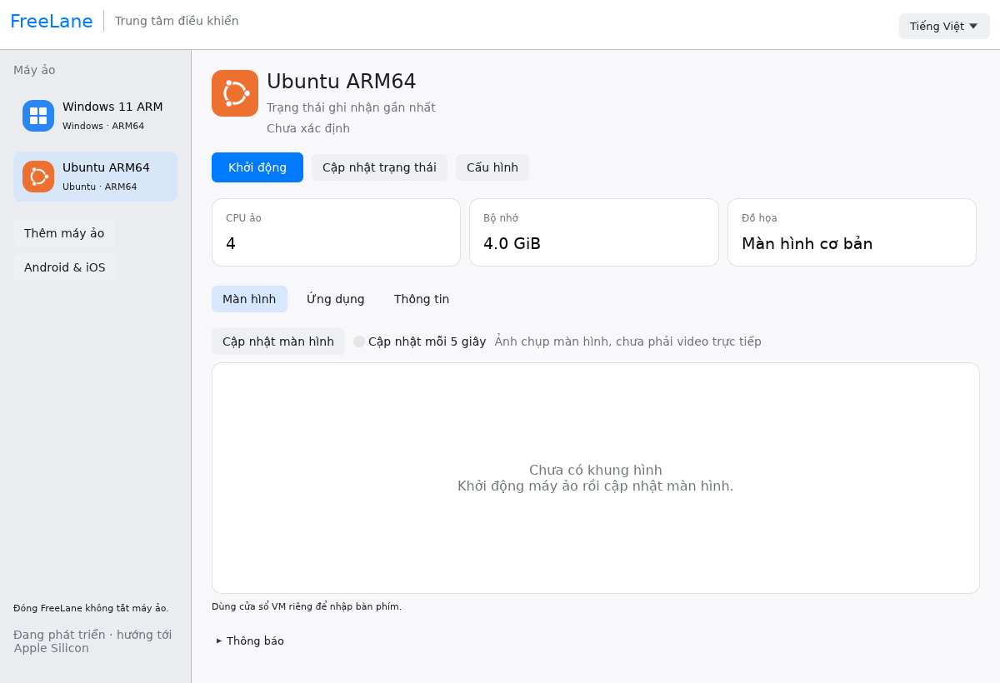
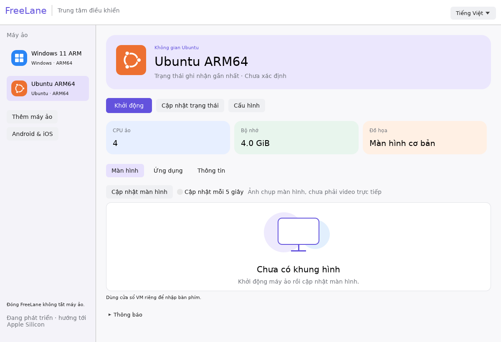

# UI review

Product Design was requested but its tools/skills were unavailable in this session. This review was performed directly on the application.

The revision keeps the existing Mac-style palette and sidebar, emphasizes the main Start action, hides lifecycle actions that cannot apply to the observed VM state, improves the resource-card label/value hierarchy and uses a light empty display surface. Actual guest frames retain their dark display background.

This is a genuine Linux Xvfb capture of the application displaying an Ubuntu configuration, without booting the guest or saving settings. It is not a Mac runtime screenshot or a guest desktop. The desktop build, clippy and Mac ARM64 cross-compilation checks passed. These changes are on main and are newer than the preview.3 DMG.

[Previous layout](assets/desktop-mac-style.png).

## Revised visual direction

After feedback that the first revision felt rigid, the layout was redesigned with a lavender workspace header, larger application identity, borderless pastel resource cards, softer sidebar selection and a monitor illustration for the empty display state. Vietnamese labels are retained.

The image is an actual Linux Xvfb capture of the app showing an Ubuntu configuration, not a live guest or native Mac screenshot. This revision is on main and is newer than the preview.3 DMG. Product Design tools remain unavailable; the design work was performed directly.
