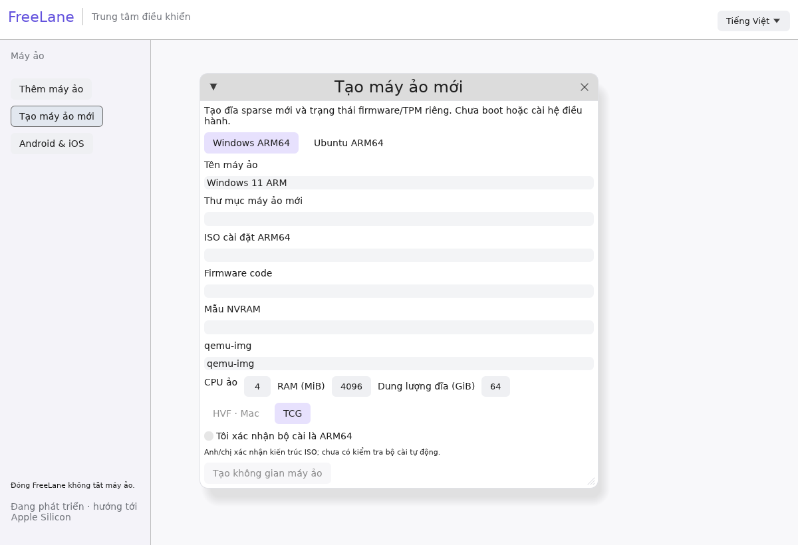

# VM creation and persisted library

The manager now has **Create virtual machine / Tạo máy ảo mới**. Select Windows or Ubuntu, a new directory, installer media, firmware code and a distinct variable template, then choose CPU/RAM/disk size and HVF or TCG explicitly. Confirm the media is ARM64 only after checking its origin/architecture yourself.



This is the first P1 creation path: it creates a sparse disk, private firmware/NVRAM/TPM state and a configuration. It does not install an OS, start a VM or infer that a guest is ready. Automatic ISO architecture inspection, native file pickers, free-space estimation, guided installation, setup recovery and checkpoints are still outstanding. QEMU/firmware/media must be supplied separately. Disk virtual size is not a reservation of physical free space.

The CLI equivalent uses [the creation-request example](../configs/create.windows.example.toml):

```sh
freelane vm-create /absolute/path/to/create-request.toml
freelane doctor-json /absolute/path/to/new-vm/vm.toml
```

Relative file paths in a request resolve against its directory; qemu-img may be a PATH executable or an explicit path. Windows requests require at least two CPUs, 4096 MiB RAM and 64 GiB disk. Ubuntu disks may start at 8 GiB. Existing VM directories and source firmware/templates are preserved. Backend failures after directory creation retain the incomplete directory for inspection; do not retry with that same path or delete user data automatically.

## Library

Opening/creating a valid VM saves a bookmark. The manager reloads saved bookmarks at startup, including missing paths so they can be repaired explicitly. A settings rename updates the bookmark. Saving uses a private directory, 0600 file, lock, read/merge and atomic file replacement. It does not copy or modify guest disks/configurations; corrupt or unsupported library files are preserved and reported rather than overwritten. Runtime readiness is still queried independently.

Default paths:

- macOS: `~/Library/Application Support/FreeLane/library.toml`.
- Linux: `$XDG_DATA_HOME/freelane/library.toml`, or `~/.local/share/freelane/library.toml`.
- Tests/portable overrides: absolute `FREELANE_LIBRARY_PATH` in a private directory.


Recorded checks: real qemu-img created a 64 GiB virtual Windows disk, preflight passed, repeat creation refused overwrite and original NVRAM template bytes stayed unchanged. Actual Linux UI saved an Ubuntu bookmark and reloaded it after restart without configuration arguments. No new guest boot or installation was performed. Physical-Mac wizard/runtime acceptance is pending.
